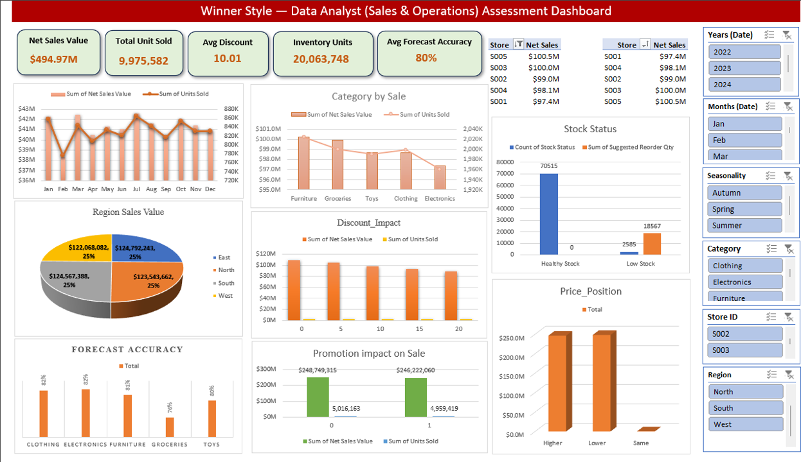

# 📊 Sales & Operations Planning (S&OP) & Data Quality Audit Dashboard

A comprehensive, executive-ready **Sales and Operations Planning (S&OP)** analytical solution and data quality audit built entirely in Microsoft Excel. This project bridges supply chain management with robust data analytics, focusing on formula optimization, rigorous error normalization, and dynamic business intelligence reporting.

---

## 🏆 Project Overview
Effective S&OP is critical for balancing market demand with inventory constraints, preventing costly stockouts, and optimizing working capital. This repository documents a complete assessment project—identifying structural flaws in raw operational data, implementing advanced mathematical fixes, and visualizing performance through an interactive Excel dashboard.

---

## 🛠️ Key Technical & Supply Chain Highlights

* **Advanced Formulas & Logic Validation**: 
  * Implemented absolute error normalization (`=ABS()`) to resolve sign discrepancies in `Forecast Error` calculations.
  * Maintained directional `+/-` indicators in **Inventory Gap** (`Inventory Level - Demand Forecast`) to accurately segregate surplus inventory from critical stockouts.
  * Configured dynamic rules for **Stock Status** and automated **Suggested Reorder Quantities**.
* **Data Quality Audit & Correction**: Cleaned raw dataset structures, standardized unit-based metrics, and corrected misaligned KPI card formats (e.g., separating monetary and unit values).
* **Executive Visualization & Layout**: 
  * Real-time KPI summary cards (*Net Sales Value*, *Total Unit Sold*, *Avg Discount*, *Inventory Units*, and *Avg Forecast Accuracy*).
  * Multi-dimensional performance tracking across regions, product categories, seasonal trends, and competitor pricing tiers (`Higher`/`Lower`/`Same`).

---

## 📈 Dashboard Preview


---

## 📂 Repository Structure

```text
├── Winner_Style_Data_Analyst_Assessment_Tarakuzzaman.xlsx   # Audited & formula-validated Excel model
├── Dashboard_winner_style.png                               # High-resolution screenshot of the final dashboard
└── README.md                                                # Project documentation
